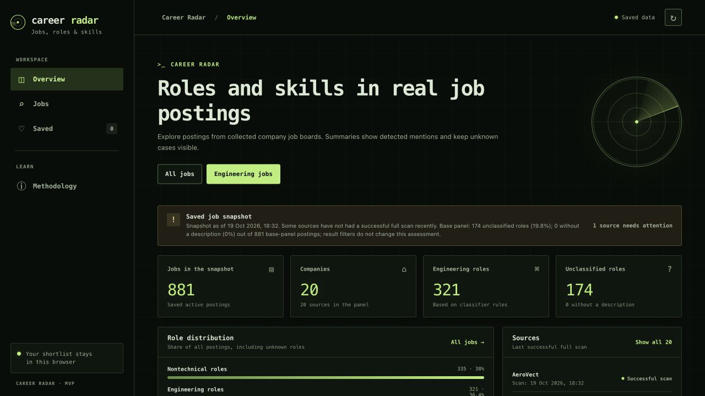

# Career OS

Career OS is a local career research tool for software engineers. It collects
public company job postings, makes roles and skill mentions searchable, and
keeps research about AI and work connected to its original evidence.

The main interface is **Career Radar**: a browser workspace for exploring a
configured panel of company job boards, inspecting posting evidence, and saving
a shortlist. The separate Research view tracks publisher documents and reviewed
claims about developer tasks, seniority, and production AI skills.

This repository contains the Python application, browser interface, database
migrations, source configurations, fictional profile examples, and tests.
It is a working local prototype for exploring career questions and the quality
of the evidence behind them.



*Example capture from a collected panel. A fresh installation starts with an
empty database; counts and source availability change between collections.*

## What you can do

- Browse saved postings by role, company, geography, work mode, and literal skill
  mentions; inspect original text and matching evidence.
- Keep a shortlist in the current browser's local storage.
- Collect public Greenhouse, Lever, and Ashby boards, with Workable public
  collection available through an explicit opt-in.
- Inspect source freshness, partial scans, unclassified roles, and whether
  historical comparisons have enough saved evidence.
- Collect research documents from a bounded publisher list and review candidate
  claims before including them in research outputs.
- Use the CLI for market reports, profile validation, manual vacancy reviews,
  and compensation comparisons with explicit provenance.

## Run locally

You need Python 3.12+, [uv](https://docs.astral.sh/uv/), Docker with Compose,
and `make`. Internet access is needed for installation and public-source
collection. The job-board workflow requires no paid API key.

### 1. Install and configure

```sh
git clone https://github.com/bknstn/career-os.git
cd career-os
uv sync --all-groups --frozen
cp .env.example .env
```

If `.env` already exists, keep it and compare it with the example. Edit `.env`
and set `POSTGRES_PASSWORD` to a locally generated value, for example the output
of `openssl rand -hex 24`. The database URL expands the other PostgreSQL
variables. These settings are for the local Compose service. `.env` is ignored
by Git.

Export settings in the shell used for application commands, then start the
database and apply migrations:

```sh
set -a
. ./.env
set +a
make db-up
make migration-up
```

Repeat the export step in a new shell. The general CLI and Alembic do not load
`.env` automatically. The Radar launcher also supports an optional ignored
`.env.radar.local` file.

### 2. Collect the example panel

```sh
uv run career-os sources validate --config config/sources.market-iteration.yaml
make radar-refresh
uv run career-os enrich
```

The checked-in Radar panel contains 20 company boards. Collection contacts
public endpoints and can produce partial or failed runs as sources change.
Inspect outcomes with `uv run career-os operations status` and
`uv run career-os runs list`.

### 3. Open Career Radar

```sh
make radar
```

Open [Career Radar](http://127.0.0.1:8765/radar/) or its
[Research view](http://127.0.0.1:8765/radar/#/research).
The server binds to `127.0.0.1:8765`. The first read can take longer while text
features are prepared. The refresh button rereads saved data; run
`make radar-refresh` to fetch boards again.

Research starts empty until its sources are collected. See the
[research operations guide](docs/CAREER_RADAR_RESEARCH_OPERATIONS.md) for
collection, review, and monitoring. Scheduling is configured separately in your
own environment.

Stop PostgreSQL with `make db-down`; the named Docker volume retains its data.

## CLI and API

Help and validation work without PostgreSQL:

```sh
uv run career-os --help
uv run career-os taxonomy validate
uv run career-os profile validate --profile config/career-profile.example.yaml
```

After collection and enrichment, generate a report using the fictional legacy
skill-profile example:

```sh
mkdir -p .local/reports
uv run career-os market report \
  --market config/market.example.yaml \
  --profile config/profile.example.yaml \
  --format markdown \
  --output .local/reports/market.md
```

For an explicit role/company/geography boundary, replace `--market` with
`--target-universe config/target-universe.template.yaml`. Review the template
against your persisted sources first. The legacy skill profile and the newer
evidence-bearing career profile are distinct formats.

`uv run career-os-api` starts the read-only API on `127.0.0.1:8000`.
Interactive documentation is at [the local API docs](http://127.0.0.1:8000/docs).
Both launchers expose unauthenticated local interfaces; hosting would require
an authentication and deployment design.

## Interpreting results

- Counts describe the configured company-board panel. They do not represent the
  entire job market. A posting on two boards can be counted twice.
- A skill match means a text mention. It does not establish a requirement,
  personal competence, hiring probability, or future demand.
- Missing or failed scans remain unknown. Only a complete successful scan can
  establish that a previously observed posting is absent.
- Historical comparisons need immutable observations for both windows. Missing
  history produces `insufficient`, rather than an invented comparison.
- Research populations and denominators stay separate from job-posting counts.
  Candidate annotations need explicit review before entering research products.
- Career reviews use manual evidence mapping. Compensation comparisons preserve
  currency, pay basis, and contract assumptions; they do not infer taxes or
  convert currencies.

## Development

```sh
make check
make security
uv run pre-commit install
```

`make check` runs Ruff formatting and linting, strict mypy, and the default test
suite. Database and live-source tests require explicit opt-in; see the
[development guide](docs/development.md).
`make security` checks public files for secret candidates and private content;
`make security-history` also checks reachable Git history.

The application uses Python, Typer, FastAPI, SQLAlchemy, Alembic, and PostgreSQL,
with a plain JavaScript/CSS interface. See the
[architecture overview](docs/architecture.md) for components and data flow.

## Documentation

- [Documentation index](docs/README.md)
- [Architecture decisions and product evolution](docs/adr/README.md)
- [Collection operations](docs/operations.md)
- [Research operations](docs/CAREER_RADAR_RESEARCH_OPERATIONS.md)
- [Input and output contracts](docs/contracts.md)
- [Private data and security reporting](SECURITY.md)
- [Contributing](CONTRIBUTING.md)

## License

[MIT License](LICENSE).
