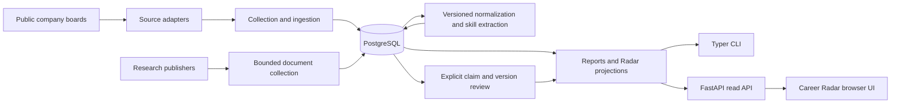

# Architecture

Career OS is a modular Python application with a PostgreSQL evidence store.
The CLI, HTTP API, and browser interface share application services.

## Product direction

The intended decision output is a **Career Thesis**: a reasoned, revisable bet
on where a software engineer should invest the next 2–5 years of career
capital. The [product thesis](PRODUCT_THESIS.md) defines this post-pivot goal.

Collection and enrichment supply evidence to Career Radar. The future personal
layer would combine those signals with a person's experience, goals,
constraints, and preferences, compare trajectories in a Career Map, and explain
a chosen direction in a Career Thesis. Each thesis would retain its evidence,
alternatives, assumptions, risks, and conditions for revision. New observations
could then prompt a review of the decision.

The current application implements the evidence and exploration foundation.
The personal Radar-to-Map-to-Thesis loop remains planned. Job observations and
reviewed research provide distinct inputs with their own populations and
limitations; their interpretation must preserve those boundaries.

## Current components and data flow

| Directory | Responsibility |
| --- | --- |
| `src/career_os/adapters/` | Public-source transport and parsing |
| `src/career_os/application/` | Workflows, transactions, report assembly |
| `src/career_os/domain/` | Source-independent contracts and invariants |
| `src/career_os/config/` | Strict file-backed inputs |
| `src/career_os/normalization/` | Job fields and skill evidence |
| `src/career_os/persistence/` | Models, repositories, queries |
| `src/career_os/radar/` | Classification and bounded aggregates |
| `src/career_os/research/` | Research text extraction |
| `src/career_os/api/` | Local HTTP interfaces |
| `src/career_os/radar_web/` | Browser application and styles |
| `migrations/` | Alembic schema changes |
| `config/` | Public manifests, taxonomy, fictional examples |
| `tests/` | Offline suites and opt-in database/live tests |

Posting identity is local to a source. Complete successful scans control
lifecycle reconciliation; partial scans never establish absence. Raw payloads,
canonical versions, and immutable observation membership have separate roles.
Enrichment can replay retained evidence using its own version markers.

Radar comparisons depend on saved observation inputs and versioned rules.
Research claims bind to document versions and exact text spans. Only explicitly
reviewed, current claims enter research outputs. Monitor state and generated
products live under ignored `.local/` paths.

The reasons for these boundaries and their evolution are in the
[architecture decision records](adr/README.md).
